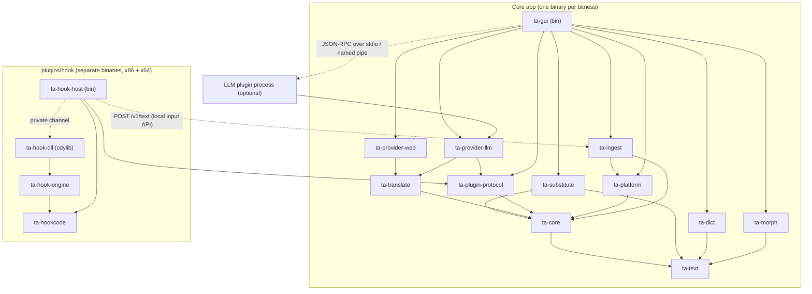

# Proposed Cargo workspace layout

A proposal only; no Cargo files exist yet. It follows `../product-direction.md` ("Revised workspace layout") and adds dependencies, `unsafe` scope and packaging. Constraints: both `i686-pc-windows-msvc` and `x86_64-pc-windows-msvc` (D1), MSRV 1.90 (D2), permissive dependencies and `MIT OR Apache-2.0` for our own crates (D3), clean reimplementation (D13).

Guiding split: pure logic (bitness-agnostic, unit-testable on any host) vs. Win32/FFI (small, isolated). The core app contains **no injection or hooking code** (D6) and **no 32-bit-only part** (D7, D9).

## Crates

| Crate | Responsibility | `unsafe` / FFI | Bitness |
|---|---|---|---|
| `ta-text` | Encodings (`encoding_rs`), kana/romaji/width conversion, matching folds, HTML entities | none | any |
| `ta-core` | Domain types: languages, contexts and their settings, pipeline (buffering, filters, dedupe), history, config (TOML) + one-time legacy import (D16), errors | none | any |
| `ta-substitute` | Substitution profiles, longest-match engine, `UserDict.txt` import/export | none | any |
| `ta-dict` | EDICT/EDICT2/ENAMDICT loading, self-authored conjugation rules (D13), JParser matching, cache | `memmap2` only | any |
| `ta-morph` | MeCab-compatible analysis: `vibrato` backend (default), optional `lindera` (external dictionaries), optional `libmecab` FFI | FFI only in the optional libmecab backend | any (libmecab must match app bitness) |
| `ta-translate` | `Translator` trait, router, result cache, rate limits, retries, cancellation | none | any |
| `ta-provider-web` | Declarative web connector (TOML definitions, session step, cookies, JSONPath) + official-API presets (D10, D17, D21) | none | any |
| `ta-provider-llm` | LLM translator (OpenAI-compatible, Anthropic); builds as a plugin binary and optionally as a library compiled into the app (D8) | none | any |
| `ta-plugin-protocol` | Versioned JSON-RPC plugin protocol: message types, handshake, host side (spawn, supervise), plugin side helpers (D15) | none (pipes via tokio) | any |
| `ta-ingest` | Clipboard listener, local input/output API server (`axum`), feeding `ta-core`'s pipeline (D5, D18) | via `ta-platform` | any |
| `ta-platform` | Thin Win32 wrappers: clipboard listener window, hotkeys, credential store, known folders, layered-window alpha | `windows` | app bitness |
| `ta-gui` (bin) | The app (`iced`, D14): frames, panes, layouts, settings UI, furigana/JParser views, wiring | via `ta-platform` | both |
| `plugins/hook/ta-hookcode` | Hook-code parser + expression evaluator (32-bit syntax + new 64-bit extension) | none | any |
| `plugins/hook/ta-hook-engine` | Per-arch inline-hook backends (x86, x86_64), default text-API hooks, capture | heavy (`windows-sys`, `iced-x86`, `retour`) | per target |
| `plugins/hook/ta-hook-dll` (cdylib) | The injected DLL; built once per bitness | heavy | per target |
| `plugins/hook/ta-hook-host` (bin) | Per-bitness plugin executable: target selection, launch profiles, injection, AGTH-code converter, forwarding text to the app's local API | `windows-sys` | per target |

Removed compared with the earlier layout: `ta-engines`, `ta-engine-host` (D7), `ta-ipc` (replaced by `ta-plugin-protocol` and the local API), `ta-inject` (now inside `ta-hook-host`), `ta-plugin-abi` (legacy ABI cut, D15), `ta-providers` (split into `ta-translate` + `ta-provider-web` + `ta-provider-llm`), `ta-sample-plugin`.

Possible additions later: `ta-testkit` (golden I/O fixtures shared by tests), `xtask` (packaging).

## Dependency graph

Solid arrows: crate dependency ("depends on"). Dashed arrows: runtime link between processes, no crate dependency.

Key properties:
- Everything under `core` except `ta-platform`, `ta-ingest` (clipboard part) and `ta-gui` is free of Win32 and testable on any host, which carries the black-box test plan (`migration-plan.md`).
- The hook plugin depends on no core crate except the protocol types; at runtime it only needs the local input API. That is what lets it move to its own repo later (D19) and lets any bitness feed any bitness.
- `ta-provider-llm` can run in-process (feature) or as a plugin process; in both cases it only uses what the protocol offers.

## Build and packaging (both bitnesses)

- CI builds the whole workspace for `i686-pc-windows-msvc` and `x86_64-pc-windows-msvc` (matrix), with `rust-version = "1.90"`, and runs `cargo deny check` against `deny.toml` for both targets.
- **App packages:** one archive per bitness, e.g. `TranslationAggregator-win32` and `-win64`, each containing:
  - `ta-gui` of that bitness;
  - the LLM plugin executable of the same bitness with its manifest (unless compiled in);
  - the web connector presets (TOML), the disabled example definitions (`examples/providers/*.toml`, D21), docs, and a generated third-party licence file;
  - no dictionaries by default (downloaded by the user, D13); if a dictionary is bundled, its licence and attribution file goes with it.
- **Hook plugin package** (optional component, separate archive or installer option), identical for both app packages because the target game decides the bitness:

| Artifact | Built from target | Purpose |
|---|---|---|
| `ta_hook_host_x86.exe` | i686 | Handles 32-bit targets; plugin entry point for the 32-bit app |
| `ta_hook_x86.dll` | i686 | Injected into 32-bit targets |
| `ta_hook_host_x64.exe` | x86_64 | Handles 64-bit targets; plugin entry point for the 64-bit app |
| `ta_hook_x64.dll` | x86_64 | Injected into 64-bit targets |
| `plugin.toml` | — | Manifest: kind = input source, executables per bitness, protocol version range |

  The host of the app's bitness is started by the app; if a chosen target has the other bitness, it starts the other host. Both hosts send text to the app the same way (local API with a context id).
- No 32-bit engine host and no legacy `Plugins\` folder for `__stdcall` DLLs.
