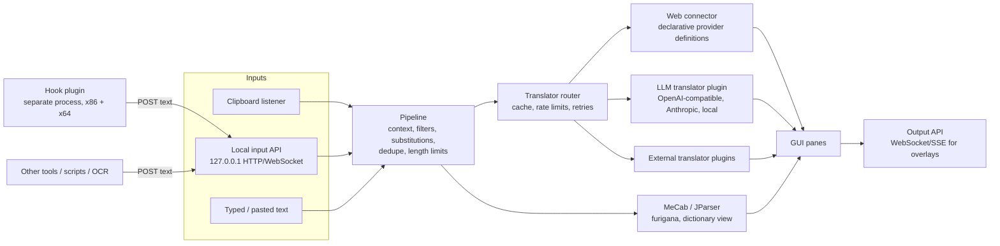

# Product direction (decision record)

This document is the **authoritative source** for the scope and target design of the Rust rewrite.
Where `docs/analysis/*` or the wiki disagree with it, this document wins.
`docs/analysis/` still describes the legacy C++ app accurately; its forward-looking parts
(`rust-mapping.md`, `workspace-layout.md`, `migration-plan.md`, `risks-and-open-questions.md`)
follow this document.

Status: decisions D1–D21 are made by the owner (2026-11-08). Items marked **Proposal** are
the recommended design and can be revised. Items under "Open" still need an owner decision.

## Decided

| # | Decision |
|---|---|
| D1 | Ship a **32-bit (i686-pc-windows-msvc) and a 64-bit (x86_64-pc-windows-msvc)** build of the whole app. |
| D2 | **MSRV: Rust 1.90.** |
| D3 | **License: the rewrite is licensed `MIT OR Apache-2.0`** (the most open option; owner asked for it, 2026-11-08). Dependencies must be permissive (MIT, Apache-2.0, BSD, ISC, Zlib, …; MPL-2.0 allowed); GPL/LGPL/AGPL crates are not allowed. Enforced by `cargo-deny`. This **supersedes** the earlier "stay GPLv2-compatible" rule. See D13 for the condition that makes it possible. |
| D4 | **The old app is the reference for *what* the app can do, not a spec to copy line by line.** |
| D5 | **Main focus: translate incoming text.** Text arrives through the **clipboard** or a **local API interface**. The app translates it into the chosen target language with every translator it has configured and shows the results side by side. |
| D6 | **Text hooking is a separate plugin, not part of the core app.** The core app contains no injection or hooking code. The hook plugin captures text from games and hands it to the app through the same input API as any other source. Extending hook codes for 64-bit games is the plugin's job. |
| D7 | **The offline translators ATLAS and LEC are cut.** This removes the 32-bit engine-host helper and the ATLAS-only features (ATLAS rule sets `.trs`, ATLAS menu/dialog translation, ATLAS dictionary search). |
| D8 | **An LLM translator is offered as an API plugin**, so modern LLMs can be used for translation. |
| D9 | **MeCab support is kept** (morphological analysis, furigana, input for the JParser dictionary view). |
| D10 | **Web translation becomes a flexible, configurable connector** instead of hard-coded scrapers. |
| D11 | **The UI looks like the old app** (the multi-pane aggregator layout) **but is modernized** with better UI and UX. |
| D12 | Local Japanese tools that aren't translators (JParser with EDICT dictionaries, furigana, substitutions/UserDict, history) are kept. |
| D13 | **Clean reimplementation, no code translation.** The legacy code is GPLv2 (no "or later" notice), so translating it to Rust would make the rewrite a GPLv2 derivative. Therefore: the legacy app is used only as a reference for **features, behaviour and file formats** (D4). No legacy source is copied or translated line by line, and no legacy-authored data files (e.g. `Conjugations.txt`, rule sets) are shipped; equivalents are built from permissive or self-made sources. Parity is checked with black-box input/output tests. Third-party data (EDICT under the EDRDG licence, MeCab dictionaries) is downloaded by the user or shipped with its own licence and attribution. |
| D14 | **GUI toolkit: `iced`** (MIT), styled to look like **classic Win32** (system fonts, native-like controls, menus, toolbars, splitters), with the modern UX features of D11 on top. Resolves O2. |
| D15 | **Plugins: only the new out-of-process protocol.** Legacy `__stdcall` plugin DLLs are not supported. Resolves O3. |
| D16 | **Settings:** legacy INI and `UserDict.txt` are imported once; the app then uses TOML. Resolves O4. |
| D17 | **First-shipped translators:** DeepL API, Google Translate (Google Cloud Translation API), Bing Translate (Microsoft Translator API, the service behind Bing), LibreTranslate, LLM via OpenAI-compatible APIs (incl. local servers) and the Anthropic API. Google and Microsoft both have free monthly tiers. Resolves O5. |
| D18 | **Local input API:** off by default, bound to `127.0.0.1` only, token optional. Resolves O6. |
| D19 | **Hook plugin** stays in this repo under `plugins/hook/` until it stabilizes. Resolves O7. |
| D20 | **Legacy quirks are fixed,** not reproduced; every behaviour change is documented. Resolves O8. |
| D21 | **Keyless Google and Bing web versions ship as custom web services**, not as built-in presets: example definitions (`examples/providers/*.toml`), disabled by default and marked *unofficial* in the UI, plus a setup guide (`docs/guides/custom-web-services.md`). The web connector must support what they need (D10): a session step that fetches a page and extracts tokens, cookie reuse, token refresh, form bodies, and JSONPath extraction with joining. Resolves O9. |

## Target architecture (Proposal)

### Inputs
- **Clipboard:** modern clipboard listener (`AddClipboardFormatListener`), with the old per-context
  options (auto translate, Japanese-only, merge, repeat filters, idle delay). Existing external text
  hookers that write to the clipboard (e.g. Textractor) work without any plugin.
- **Local input API (Proposal):** HTTP + WebSocket bound to `127.0.0.1` only, off by default,
  optional token. Minimal surface: `POST /v1/text` (text, source/context id, optional language),
  a WebSocket/SSE stream of incoming text and translations (for overlays, OBS, scripts), and
  `GET /v1/status`. Versioned (`/v1`), documented with a schema.

### Translators
- **Translator trait** in the core: `translate(text, src, dst, context) -> stream of result`, plus
  capabilities (languages, max length, streaming, cost hint). Router fans out to enabled
  translators, caches results, enforces per-provider rate limits and the auto-request length cap.
- **Web connector (D10, D21, Proposal):** a provider is **data, not code**: a TOML definition with
  endpoint, method, headers, auth (secrets read from the OS credential store), request body template
  (JSON, form or query), response extraction (JSONPath, optional join of several matches; regex for
  non-JSON replies), language-code mapping, limits. An optional **session step** fetches a page first,
  extracts values with regexes, keeps cookies, and refreshes after N uses, a time limit or given HTTP
  statuses. Ship presets for **official APIs** (D17). Users can add, import or edit definitions in the
  settings UI without a rebuild, with a "Test" button that shows the raw request and response.
  Providers that need real logic (request signing, computed tokens) are written as translator plugins.
  Unofficial keyless endpoints are **not** built-in presets; the Google and Bing web versions ship as
  disabled custom-service examples with a guide (D21). Format: `docs/guides/custom-web-services.md`.
- **LLM translator plugin (D8, Proposal):** first-party plugin. Backends: OpenAI-compatible Chat
  Completions (covers many hosted services and local servers such as Ollama, LM Studio, llama.cpp
  server) and the Anthropic Messages API. Configurable endpoint, model, temperature, prompt template
  (source/target language, tone), optional glossary from the user dictionary, optional previous lines
  as context (important for dialogue), streaming output, token/cost display. Model names are user
  settings, never hard-coded. API keys live in the OS credential store, not in config files.

### MeCab (D9, Proposal)
- Default backend: a pure-Rust analyzer that reads MeCab-format dictionaries: **`vibrato`**
  (MIT OR Apache-2.0, MSRV 1.88). No DLL, so no bitness problem in either build.
- Fallback: `lindera` (MIT, MSRV 1.88) **only with external dictionary files**. Its `embed-*`
  features download dictionaries at build time and pull `webpki-roots` (CDLA-Permissive-2.0, not in
  the license allow-list).
- Optional backend: load an installed `libmecab` of matching bitness via FFI, for users who rely on
  their own MeCab setup.
- Dictionaries are data with their own licences: IPADIC (NAIST/ICOT notice licence), UniDic 2.1.2
  (usable under BSD-3-Clause). By default the user downloads one; a bundled dictionary ships with its
  licence and attribution (D13).
- Verified 2026-11-08 (details: `docs/analysis/rust-mapping.md` §5, §14).

### Plugins (Proposal)
- **Primary plugin model: out-of-process.** A plugin is a separate executable that talks a versioned
  JSON-RPC protocol (stdio or local socket) or the local input API. Benefits: any bitness can talk to
  any bitness (a 32-bit hook plugin can feed the 64-bit app), crash isolation, any language.
- **Plugin kinds:** input source (e.g. hook), translator (e.g. LLM, signed-request web services),
  text transform (pre/post substitution, replaces the legacy `__stdcall` plugin DLLs).
- **First-party plugins:** LLM translator, hook plugin. They may be compiled into the main binary as an
  optional feature as well, but must not need anything the protocol doesn't offer.

### Hook plugin (D6, Proposal)
- Lives in its own folder (`plugins/hook/`) and can later move to its own repo.
- Contains everything injection-related from the legacy `dll/` + injector: hook-code parser/evaluator,
  hook DLL built per bitness, injector helpers per bitness, launch profiles.
- Sends captured text to the app via the local input API with a context id (process/thread/hook).
- Hook-code syntax for 64-bit is designed inside this plugin.

### UI (D11, Proposal)
- **Keep the recognisable layout and workflow:** "Original Text" pane plus one pane per translator,
  multiple frames, one/two columns with splitters, saved layouts (Alt-0..9), transparency,
  always-on-top, hide frame/toolbars, keyboard shortcuts, history back/forward, furigana and JParser panes.
- **Modernize:** light/dark themes, high-DPI and font scaling, a settings UI instead of INI editing,
  per-pane actions (copy, retry, pin, show request time/status/cost), provider health indicators,
  searchable history, a command palette, side-by-side comparison, keyboard accessibility.
- The concrete look is agreed in a separate UI design step before the GUI is built.
- GUI toolkit: `iced`, themed in classic Win32 style (D14).

## Revised workspace layout (Proposal)

| Crate | Responsibility | Bitness |
|---|---|---|
| `ta-core` | Domain types, config, languages, contexts, history, errors | any |
| `ta-text` | Kana/width folding, romaji/kana conversion, encodings (`encoding_rs`), HTML entities | any |
| `ta-substitute` | Substitution profiles, `UserDict.txt` import/export, longest-match engine | any |
| `ta-dict` | EDICT/ENAMDICT, conjugations, JParser matching, cache | any |
| `ta-morph` | MeCab-compatible analysis (pure-Rust backend + optional libmecab FFI) | any |
| `ta-translate` | `Translator` trait, router, cache, rate limiting | any |
| `ta-provider-web` | Declarative web connector + official-API presets | any |
| `ta-provider-llm` | LLM translator (first-party plugin) | any |
| `ta-plugin-protocol` | Versioned JSON-RPC plugin protocol + host side | any |
| `ta-ingest` | Clipboard listener + local input/output API server | any (Win32 for clipboard) |
| `ta-platform` | Thin Win32 wrappers (clipboard, hotkeys, credential store, known folders) | GUI bitness |
| `ta-gui` (bin) | The app; built for i686 and x86_64 | both |
| `plugins/hook/*` | `ta-hookcode`, `ta-hook-engine`, `ta-hook-dll` (cdylib, x86 + x64), `ta-hook-host` (bin: injector + launcher, per bitness) | per target |

Removed compared with `docs/analysis/workspace-layout.md`: `ta-engines`, `ta-engine-host` (D7),
`ta-ipc` (replaced by `ta-plugin-protocol` + the local API), `ta-inject` (moved into the hook plugin),
`ta-plugin-abi` (legacy ABI, see O3).

## Open

O1–O9 are resolved by D3 and D13–D21. New open questions are added here as they come up.

| # | Question | Recommendation |
|---|---|---|
| O10 | Default auto-translate for remote (paid/LLM) providers? | Off (as for remote panes in the old app), with per-provider budgets. |
| O11 | Bundle a MeCab dictionary and/or EDICT, or download on first use? | Download on first use and show the licence; bundle only with licence and attribution. |
| O12 | Require the token for the local API output stream even if input stays tokenless? | Yes when the stream is enabled; warn in settings. |
| O13 | Japanese-locale launch in the hook plugin (AppLocale is obsolete): reimplement, or point to external tools? | Point to external tools. |
| O14 | Native Win32 menu bar (attached via the window handle) or iced-drawn menus? | Decide in the UI design step after a short spike. |
| O15 | D18 binds the local API to `127.0.0.1` only. Clients that resolve `localhost` to IPv6 `::1` first may fail to connect. Also listen on `::1`? | Yes: listen on both loopback addresses (`127.0.0.1` and `::1`), never on other interfaces. This keeps D18's "loopback only" intent. |
| O16 | Default port of the local API? | A fixed, configurable default that no common tool uses; pick it when the v1 API document is written and check it against the IANA port registry. |
